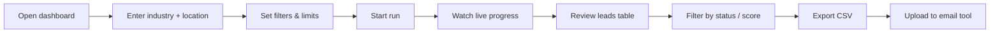
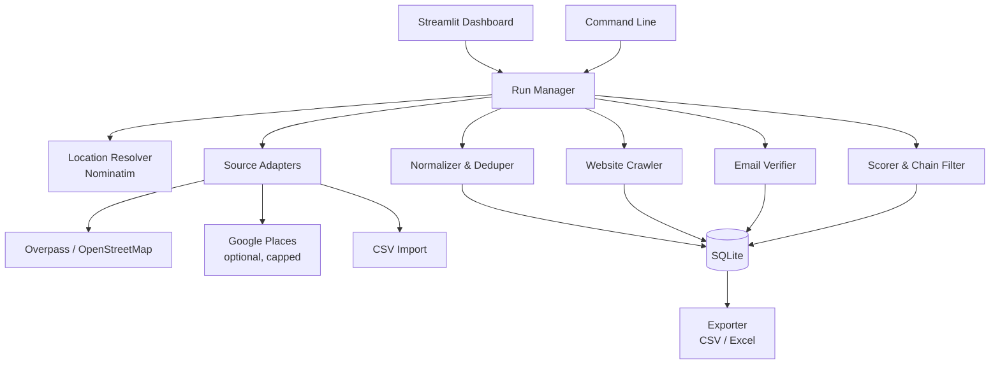

# LeadScout — Project Plan

> A free, self-hosted lead generation tool. You choose the **industry** and **location**; LeadScout finds small businesses, extracts their emails from their websites, verifies them, scores them, and exports clean CSVs.

| | |
|---|---|
| **Status** | Phase 1 built (CLI); Phase 2–3 partly built; see docs/DECISIONS.md |
| **Version** | 0.1 (plan) |
| **Cost to run** | $0 (optional Google Places stays inside the free tier via a hard cap) |
| **Runs on** | Windows,macos(Python 3.11+) |

---

## Table of Contents

1. [Project Overview](#1-project-overview)
2. [Roles & Responsibilities](#2-roles--responsibilities)
3. [Scope](#3-scope)
4. [Success Metrics](#4-success-metrics)
5. [Phases & Timeline](#5-phases--timeline)
6. [Design (UX / UI)](#6-design-ux--ui)
7. [System Architecture](#7-system-architecture)
8. [Folder Structure](#8-folder-structure)
9. [Pipeline — Stage by Stage](#9-pipeline--stage-by-stage)
10. [Database Schema](#10-database-schema)
11. [Configuration](#11-configuration)
12. [Command-Line Interface](#12-command-line-interface)
13. [Export Formats](#13-export-formats)
14. [Non-Functional Requirements](#14-non-functional-requirements)
15. [Compliance & Ethics](#15-compliance--ethics)
16. [Testing Plan](#16-testing-plan)
17. [Risks & Mitigations](#17-risks--mitigations)
18. [Task Backlog](#18-task-backlog)
19. [Definition of Done](#19-definition-of-done)

---

## 1. Project Overview

### Problem
Paid lead databases (Apollo, ZoomInfo, etc.) cost money and credits. Free tiers give only a few hundred contacts a month. Small, independent businesses are also under-represented and poorly described in those databases.

### Solution
A local tool that builds lead lists from **free, open sources**:

1. **OpenStreetMap** (via Overpass API) for business listings
2. **Business websites** crawled politely for emails and contact data
3. **Free email verification** (syntax, domain/MX, optional mailbox check)
4. **Scoring** that estimates how likely a lead is to be a small, independent business

### Target user
A solo founder, freelancer, or small agency doing B2B outreach who wants full control over *who* is targeted and *where*, without paying per lead.

### Core promise
> Type an industry and a place → get a verified, deduplicated, scored lead list → download it as CSV.

### Important limitation (stated up front)
Revenue and MRR are **not public** for private small businesses. LeadScout cannot filter by MRR. It uses **proxy signals** (independent vs chain, single location, team size hints, website signals) to approximate "small business."

---

## 2. Roles & Responsibilities

This is a solo project, so one person wears every hat. Each role below is a *hat*: a way of thinking with its own responsibilities, deliverables, and decisions. When working, be clear about which hat you are wearing.

### 2.1 Project Manager (PM)

**Mission:** Ship a working tool in phases, keep scope under control, and make sure it produces real, usable leads.

| Responsibilities | Deliverables |
|---|---|
| Define scope, non-goals, and priorities | This `PROJECT.md` |
| Break work into phases and tasks | Task backlog (Section 18) |
| Track progress weekly | Updated task statuses |
| Decide trade-offs (speed vs accuracy vs cost) | Decision log in `docs/DECISIONS.md` |
| Run a real-world test after each phase | Phase review notes |
| Own risks and compliance checklist | Risk table (Section 17) |

**Key decisions owned:** what goes into each phase, when a phase is "done," what gets cut.

### 2.2 Designer (UX / UI)

**Mission:** Make the tool simple to control. A non-technical user should be able to run a search and export leads without reading code.

| Responsibilities | Deliverables |
|---|---|
| Map user flows (search → review → export) | User flow diagrams (Section 6.1) |
| Design each dashboard screen | Wireframes (Section 6.3) |
| Define labels, statuses, colors, and empty/error states | Design system notes (Section 6.4) |
| Design CLI output so progress is readable | CLI output spec (Section 12) |
| Test usability with a first-time user | Usability notes |

**Key decisions owned:** screen layout, wording, which filters are visible by default, how statuses are shown.

### 2.3 Developer

**Mission:** Build a reliable, polite, resumable pipeline with clean data.

| Responsibilities | Deliverables |
|---|---|
| Architecture and module design | Section 7 + code structure |
| Data sources (Overpass, Nominatim, Google Places) | `sources/` modules |
| Website crawler and email extraction | `crawler/` module |
| Email verification | `verify/` module |
| Scoring, database, export | `scoring/`, `db/`, `export/` modules |
| Dashboard (Streamlit) and CLI | `app/`, `cli.py` |
| Tests, logging, error handling | `tests/`, log files |

**Key decisions owned:** libraries, data model, concurrency, retry logic.

### 2.4 Supporting hats (part-time)

- **QA / Tester:** checks data quality on sample runs (are emails real? are chains filtered?).
- **Compliance owner:** reviews rate limits, robots.txt handling, suppression list, and outreach rules before any campaign.

### 2.5 RACI summary

| Area | PM | Designer | Developer | QA | Compliance |
|---|---|---|---|---|---|
| Scope & phases | **A/R** | C | C | I | C |
| User flows & screens | A | **R** | C | C | I |
| Data pipeline | A | I | **R** | C | C |
| Email verification | A | I | **R** | C | I |
| Scoring logic | **A** | C | R | C | I |
| Dashboard build | A | C | **R** | C | I |
| Data quality checks | A | I | C | **R** | I |
| Compliance rules | A | I | R | I | **R** |

*R = Responsible, A = Accountable, C = Consulted, I = Informed*

---

## 3. Scope

### In scope

- Search by **industry** (plain words or custom map tags) and **location** (city/region/country, point + radius, or batch list of cities)
- Business data from OpenStreetMap (free), with optional Google Places (free tier, hard-capped)
- CSV import of existing business/website lists for enrichment
- Website crawling for emails, phone numbers, and social links
- Email verification with clear statuses
- Chain filtering and small-business lead scoring
- Local SQLite database: dedupe, resume, history, suppression list
- CSV / Excel export with filters and column selection
- Streamlit dashboard + command-line interface

### Out of scope (non-goals)

- Sending emails (use a dedicated cold email tool)
- Scraping LinkedIn or any site that forbids it in its terms
- Guessing emails by pattern (e.g. `firstname@domain`) and sending to unverified guesses
- Revenue / MRR data (not publicly available)
- Hosting as a public web service or reselling data

---

## 4. Success Metrics

| Metric | Target (Phase 1) | Target (Phase 3) |
|---|---|---|
| Businesses found per city-industry search | Matches OSM coverage | + Google Places coverage |
| Websites where an email is found | ≥ 30% | ≥ 45% |
| Found emails labeled **Valid** | ≥ 60% | ≥ 70% |
| Chains wrongly kept (manual sample of 100) | ≤ 15% | ≤ 5% |
| Websites crawled per hour (normal laptop) | ≥ 1,000 | ≥ 3,000 |
| Run resumes after crash with no lost work | — | 100% |
| Money spent | $0 | $0 |

---

## 5. Phases & Timeline

| Phase | Goal | Duration | Output |
|---|---|---|---|
| **Phase 1 — Core** | Get real leads end to end | Week 1 | CLI tool: search → crawl → basic verify → CSV |
| **Phase 2 — Control & Quality** | Make it easy and accurate | Week 2 | Dashboard, database, dedupe, resume, scoring, batch cities |
| **Phase 3 — Power** | Maximize coverage and accuracy | Week 3 | Google Places (capped), mailbox verification, catch-all detection, suppression list, export templates |
| **Phase 4 — Polish (optional)** | Nice-to-haves | Later | Scheduling, Google Sheets export, multi-language contact pages |

### Milestones

- **M1 (end of Week 1):** First real CSV of 500+ leads from one city + one industry
- **M2 (end of Week 2):** Non-technical user can run a search from the dashboard and export
- **M3 (end of Week 3):** A 10-city batch run completes overnight, resumes after interruption, and produces a scored, verified export

---

## 6. Design (UX / UI)

### 6.1 Main user flow



### 6.2 Secondary flows

- **Batch run:** paste a list of cities → pick industry → start → come back later → export.
- **Enrich my list:** upload a CSV of websites → crawl + verify → export.
- **Unsubscribe handling:** paste emails/domains into the suppression list → they never appear in exports again.
- **Resume:** reopen the dashboard after a crash → "Resume run" button continues where it stopped.

### 6.3 Screens (wireframes)

#### Screen 1 — New Search

```
┌──────────────────────────────────────────────────────────────┐
│  LeadScout                         [New Search] Runs Leads ⚙ │
├──────────────────────────────────────────────────────────────┤
│  INDUSTRY                                                    │
│  [ dentist, orthodontist          ]  (+ add custom map tag)  │
│                                                              │
│  LOCATION                                                    │
│  (•) Place name   [ Austin, Texas, USA            ]          │
│  ( ) Point+radius [ address / lat,lng ] [ 20 ] km            │
│  ( ) Batch list   [ paste one city per line       ]          │
│                                                              │
│  SOURCES                                                     │
│  [x] OpenStreetMap (free)   [ ] Google Places (capped)       │
│                                                              │
│  FILTERS                                                     │
│  [x] Must have website      [x] Exclude chains               │
│  Max results [ 2000 ]       Min score [ 0 ]                  │
│                                                              │
│  VERIFICATION                                                │
│  (•) Basic (syntax + domain)   ( ) Full (mailbox check)      │
│                                                              │
│                              [ Preview count ]  [ ▶ Start ]  │
└──────────────────────────────────────────────────────────────┘
```

"Preview count" runs only the map search and shows how many businesses exist before committing to a full crawl.

#### Screen 2 — Run Progress

```
┌──────────────────────────────────────────────────────────────┐
│  Run #14 · dentist · Austin, Texas          [Pause] [Stop]   │
├──────────────────────────────────────────────────────────────┤
│  1. Found businesses   ██████████████████████  1,240 / 1,240 │
│  2. Crawled websites   ████████████░░░░░░░░░░    690 /   980 │
│  3. Verified emails    ███████░░░░░░░░░░░░░░░    310 /   402 │
│  4. Scored             ██████░░░░░░░░░░░░░░░░    290 /   402 │
│                                                              │
│  Emails found: 402 (41%)   Valid: 251   Risky: 48   Bad: 11  │
│  Chains removed: 86        Errors: 23 (view log)             │
│  Elapsed 00:42:10          Est. remaining 00:18:00           │
└──────────────────────────────────────────────────────────────┘
```

#### Screen 3 — Leads Table

```
┌──────────────────────────────────────────────────────────────┐
│  Filters: Industry[all▾] Location[all▾] Status[Valid▾]       │
│           Score ≥ [60]  Email type[any▾]  [ ] Only new       │
├──────────────────────────────────────────────────────────────┤
│  Business        Email              Status  Score  City      │
│  Smile Studio    anna@smilest...    Valid    88   Austin     │
│  Lake Dental     info@lakedent...   Risky    61   Austin     │
│  ...                                                         │
├──────────────────────────────────────────────────────────────┤
│  1,204 leads match      [Columns ▾]   [⬇ Export CSV/Excel]   │
└──────────────────────────────────────────────────────────────┘
```

Clicking a row opens a **detail panel**: all emails found, pages they came from, phone, socials, score breakdown, and source.

#### Screen 4 — Runs History

List of all past runs with date, industry, location, counts, status (Done / Paused / Failed), and buttons: **Resume**, **Re-run**, **View leads**.

#### Screen 5 — Settings

- Crawl speed (requests per second, pages per site, timeouts)
- Google Places: on/off, API key, monthly budget cap
- Mailbox verification: on/off, sender domain used for checks
- Suppression list: add/remove emails and domains, import/export
- Industry mappings: view and edit word → map tag mappings

### 6.4 Design system notes

**Status colors (always paired with text, never color alone):**

| Status | Color | Meaning |
|---|---|---|
| Valid | Green | Domain + mailbox confirmed, or domain confirmed in basic mode |
| Risky | Amber | Catch-all domain, or generic inbox, or could not fully confirm |
| Invalid | Red | Bad syntax, no mail server, or mailbox rejected |
| Unknown | Grey | Check failed or timed out |
| Suppressed | Black | On the do-not-contact list |

**Wording rules:**
- Use plain language: "Businesses found," not "Entities retrieved."
- Every number on screen should answer "out of how many?"
- Every error should say what happened and what to do next.

**Empty states:**
- No results → "No businesses found for *dentist* in *X*. Try a nearby larger city, a radius search, or another industry word."
- Low website coverage → "Only 12% of these businesses list a website on OpenStreetMap. Turning on Google Places may help."

---

## 7. System Architecture



### Design principles

1. **Each stage is independent.** Stages read pending work from the database and write results back. This is what makes pause, resume, and re-runs possible.
2. **Save as you go.** Every result is written immediately, never held only in memory.
3. **Polite by default.** Rate limits, robots.txt, and honest identification are on by default.
4. **Sources are pluggable.** Adding a new source means adding one adapter file with a standard interface.
5. **Free by default.** Anything that could cost money is off by default and hard-capped when on.

### Tech stack

| Part | Choice | Why |
|---|---|---|
| Language | Python 3.11+ | Rich ecosystem, easy to run anywhere |
| HTTP | `httpx` (async) | Fast parallel crawling |
| HTML parsing | `beautifulsoup4` + `lxml` | Reliable, forgiving parser |
| Email validation | `email-validator` | Syntax + normalization |
| DNS / MX | `dnspython` | Mail server lookups |
| Database | SQLite (built into Python) | Zero setup, single file |
| Data handling | `pandas`, `openpyxl` | CSV / Excel export |
| Dashboard | `streamlit` | Quick, free, local UI |
| Config | `pyyaml` | Human-readable settings |
| CLI | `typer` | Clean commands and help text |
| Robots rules | `urllib.robotparser` (built-in) | robots.txt compliance |
| Tests | `pytest` | Standard testing |

---

## 8. Folder Structure

```
leadscout/
├── PROJECT.md                 # This plan
├── README.md                  # Setup + quick start
├── requirements.txt
├── config.yaml                # User settings
├── cli.py                     # Command-line entry point
├── app/
│   └── dashboard.py           # Streamlit dashboard
├── leadscout/
│   ├── run_manager.py         # Orchestrates stages, pause/resume
│   ├── location.py            # Nominatim geocoding → area / bbox
│   ├── industries.py          # Word → map tag mapping
│   ├── sources/
│   │   ├── base.py            # Source interface
│   │   ├── overpass.py
│   │   ├── google_places.py
│   │   └── csv_import.py
│   ├── normalize.py           # Clean names, domains, phones; dedupe keys
│   ├── crawler/
│   │   ├── fetcher.py         # Async fetch, retries, robots.txt
│   │   ├── pages.py           # Which pages to visit
│   │   └── extract.py         # Emails, phones, socials, tech
│   ├── verify/
│   │   ├── syntax.py
│   │   ├── dns_check.py
│   │   ├── smtp_check.py      # Optional mailbox check
│   │   └── lists.py           # Disposable + junk patterns
│   ├── scoring/
│   │   ├── chains.py
│   │   └── score.py
│   ├── db/
│   │   ├── schema.sql
│   │   └── store.py
│   └── export/
│       ├── exporter.py
│       └── templates.py       # Column presets for email tools
├── data/
│   ├── leadscout.db           # Created on first run
│   ├── industry_map.yaml
│   ├── known_chains.txt
│   └── disposable_domains.txt
├── exports/                   # CSV / Excel outputs
├── logs/
├── docs/
│   └── DECISIONS.md
└── tests/
```

---

## 9. Pipeline — Stage by Stage

Each business moves through statuses: `found → crawled → verified → scored → exported`. Failures are recorded with a reason, never silently dropped.

### Stage 1 — Resolve location

- Input: place name, point + radius, or list of places.
- Place name → **Nominatim** lookup → OpenStreetMap relation ID → Overpass area ID (`3600000000 + relation_id`).
- Point + radius → Overpass `around` filter.
- Nominatim rules: max **1 request per second**, send a real User-Agent with contact info, cache results in the database.

### Stage 2 — Map industry to tags

`data/industry_map.yaml` maps plain words to OpenStreetMap tags. The user can edit or extend it.

| User types | OpenStreetMap tag(s) |
|---|---|
| dentist | `amenity=dentist` |
| restaurant | `amenity=restaurant` |
| cafe | `amenity=cafe` |
| plumber | `craft=plumber` |
| electrician | `craft=electrician` |
| lawyer | `office=lawyer` |
| accountant | `office=accountant` |
| real estate | `office=estate_agent` |
| marketing agency | `office=advertising_agency` |
| IT company | `office=it` |
| hair salon | `shop=hairdresser` |
| beauty salon | `shop=beauty` |
| gym | `leisure=fitness_centre` |
| vet | `amenity=veterinary` |
| physiotherapist | `healthcare=physiotherapist` |
| car repair | `shop=car_repair` |
| hotel | `tourism=hotel` |

For Google Places, the plain word itself is used as the text query (e.g. "dentist in Austin, Texas").

### Stage 3 — Fetch businesses

**Overpass example query:**

```
[out:json][timeout:180];
area(id:{AREA_ID})->.a;   // AREA_ID = 3600000000 + relation ID from Nominatim
nwr["amenity"="dentist"](area.a);
out center tags;
```

- Keep fields: name, address tags, phone, website, email, brand tags, lat/lng, OSM ID.
- Public Overpass servers are shared: keep to 1–2 queries at a time, back off on errors (HTTP 429/504), and split very large areas into smaller ones.

**Google Places (optional):**
- Off by default. Requires an API key and billing enabled on Google Cloud.
- Hard cap in `config.yaml` (e.g. stop at 900 requests/month), tracked in the database.
- Request only needed fields via field mask to control which pricing tier applies.
- Store only what Google's terms allow; keep the place ID as the reference.

### Stage 4 — Normalize & dedupe

- Domain: lowercase, strip `www.`, strip paths → `smilestudio.com`
- Phone: convert to international format (E.164)
- Name: lowercase, remove punctuation and words like "LLC", "Inc", "Ltd"
- Duplicate if any match: same domain, same phone, or same normalized name within ~100 m.
- Merge duplicates, keeping all sources on record.

### Stage 5 — Crawl websites

**Pages visited (in order, max 5 per site by default):**
1. Homepage
2. Links on the homepage containing: `contact`, `about`, `team`, `impressum`, `kontakt`, `staff`, `people`
3. Common fallbacks if not linked: `/contact`, `/contact-us`, `/about`

**Rules:**
- Check robots.txt first; skip disallowed pages.
- Max 1 request/second per domain; many domains in parallel (default 20).
- Timeout 10 s, 2 retries with backoff, follow redirects, record final URL.
- Honest User-Agent: `LeadScout/0.1 (+contact email)`.

**What to extract:**

| Data | How |
|---|---|
| Emails | `mailto:` links, text pattern match, de-obfuscation of `name [at] domain [dot] com` and HTML entities |
| Phones | `tel:` links, pattern match |
| Socials | Links to LinkedIn, Facebook, Instagram, X, YouTube |
| Platform | Detect Shopify, WordPress, Wix, Squarespace from page markers |
| Activity | Latest copyright year in footer |
| Team size hint | Count of people on team/staff page; presence of careers page |

**Junk email filter — discard if:**
- Ends in image/file extensions (`@2x.png`, `.jpg`, `.webp`)
- Belongs to known tech/tracking domains (e.g. `sentry.io`, `wixpress.com`, `example.com`)
- Is a placeholder (`you@`, `name@`, `email@`, `user@domain.com`)
- Domain has no relation to the business AND is not a common mailbox provider

**Email type labels:** `personal` (e.g. `anna@`), `generic` (`info@`, `contact@`, `hello@`, `office@`), `role` (`sales@`, `support@`, `billing@`).

### Stage 6 — Verify emails

| Check | Mode | Result if failed |
|---|---|---|
| Syntax valid | Basic | Invalid |
| Disposable domain | Basic | Invalid |
| Domain has MX (or A) record | Basic | Invalid |
| Mailbox exists (SMTP `RCPT TO`, no email sent) | Full | Invalid if hard reject |
| Catch-all (random address also accepted) | Full | Risky |
| Timeout / greylisting / blocked | Full | Unknown |

**Notes for the mailbox check:**
- Many home ISPs and cloud providers block outbound port 25. The tool detects this on startup and falls back to Basic mode with a clear warning.
- Limit to a few checks per mail server per minute to avoid being blocked.
- Never actually send a message.

### Stage 7 — Chain filter & scoring

**Chain detection (any = chain):**
- OSM `brand` or `brand:wikidata` tag present
- Same normalized name appears ≥ 3 times in the dataset
- Name or domain matches `data/known_chains.txt`
- Website lists many locations (location-finder page detected)

**Lead score (0–100):**

| Signal | Points |
|---|---|
| Email status: Valid (25) / Risky (10) | 25 |
| Email type: personal (15) / generic (5) / role (3) | 15 |
| Independent (not a chain) | 20 |
| Single location | 10 |
| Phone present | 10 |
| Website active (copyright year within 2 years) | 10 |
| At least one social profile | 5 |
| Small-team signal (≤ 50 people on team page, or no large careers section) | 5 |
| **Total** | **100** |

Weights live in `config.yaml` so they can be tuned. The detail panel shows the breakdown for every lead.

---

## 10. Database Schema

SQLite, single file at `data/leadscout.db`.

```sql
-- Every search the user starts
CREATE TABLE runs (
    id              INTEGER PRIMARY KEY,
    created_at      TEXT NOT NULL,
    industries      TEXT NOT NULL,          -- JSON list
    location_input  TEXT NOT NULL,          -- what the user typed
    location_type   TEXT NOT NULL,          -- place | radius | batch
    sources         TEXT NOT NULL,          -- JSON list
    settings        TEXT NOT NULL,          -- JSON snapshot of filters/config
    status          TEXT NOT NULL,          -- running | paused | done | failed
    stats           TEXT                    -- JSON counts per stage
);

-- One row per unique business (deduped across all runs)
CREATE TABLE businesses (
    id              INTEGER PRIMARY KEY,
    name            TEXT NOT NULL,
    name_norm       TEXT NOT NULL,
    industry        TEXT,
    address         TEXT,
    city            TEXT,
    region          TEXT,
    country         TEXT,
    lat             REAL,
    lng             REAL,
    phone           TEXT,
    website         TEXT,
    domain          TEXT,
    socials         TEXT,                   -- JSON
    platform        TEXT,                   -- shopify | wordpress | ...
    is_chain        INTEGER DEFAULT 0,
    chain_reason    TEXT,
    score           INTEGER,
    score_detail    TEXT,                   -- JSON breakdown
    stage           TEXT NOT NULL,          -- found | crawled | verified | scored
    error           TEXT,
    first_seen      TEXT NOT NULL,
    updated_at      TEXT NOT NULL
);
CREATE UNIQUE INDEX idx_business_domain ON businesses(domain) WHERE domain IS NOT NULL;
CREATE INDEX idx_business_phone ON businesses(phone);
CREATE INDEX idx_business_stage ON businesses(stage);

-- Where each business came from (a business can have several sources)
CREATE TABLE business_sources (
    business_id     INTEGER REFERENCES businesses(id),
    run_id          INTEGER REFERENCES runs(id),
    source          TEXT NOT NULL,          -- osm | google | csv
    source_ref      TEXT,                   -- OSM ID / place ID / row number
    PRIMARY KEY (business_id, source, source_ref)
);

-- Emails found on business websites
CREATE TABLE emails (
    id              INTEGER PRIMARY KEY,
    business_id     INTEGER REFERENCES businesses(id),
    email           TEXT NOT NULL UNIQUE,
    email_type      TEXT,                   -- personal | generic | role
    found_on_url    TEXT,
    status          TEXT,                   -- valid | risky | invalid | unknown
    status_reason   TEXT,
    is_catch_all    INTEGER,
    verified_at     TEXT
);

-- Crawl cache to avoid re-fetching the same pages
CREATE TABLE crawl_pages (
    url             TEXT PRIMARY KEY,
    domain          TEXT,
    http_status     INTEGER,
    fetched_at      TEXT,
    error           TEXT
);

-- Do-not-contact list (emails or whole domains)
CREATE TABLE suppression (
    value           TEXT PRIMARY KEY,       -- email or domain
    kind            TEXT NOT NULL,          -- email | domain
    reason          TEXT,                   -- unsubscribed | bounced | manual
    added_at        TEXT NOT NULL
);

-- Record of every export, so "only new leads" works
CREATE TABLE exports (
    id              INTEGER PRIMARY KEY,
    created_at      TEXT NOT NULL,
    filters         TEXT NOT NULL,          -- JSON
    file_path       TEXT NOT NULL,
    row_count       INTEGER
);
CREATE TABLE export_items (
    export_id       INTEGER REFERENCES exports(id),
    email_id        INTEGER REFERENCES emails(id),
    PRIMARY KEY (export_id, email_id)
);

-- Cached lookups and API usage tracking
CREATE TABLE geocode_cache (
    query           TEXT PRIMARY KEY,
    result          TEXT NOT NULL,
    cached_at       TEXT NOT NULL
);
CREATE TABLE api_usage (
    month           TEXT NOT NULL,          -- YYYY-MM
    api             TEXT NOT NULL,          -- google_places
    requests        INTEGER DEFAULT 0,
    PRIMARY KEY (month, api)
);
```

---

## 11. Configuration

`config.yaml` (all defaults are free and polite):

```yaml
general:
  user_agent: "LeadScout/0.1 (+mailto:you@yourdomain.com)"
  database: data/leadscout.db
  export_dir: exports/

sources:
  overpass:
    enabled: true
    endpoint: https://overpass-api.de/api/interpreter
    max_concurrent_queries: 1
    timeout_seconds: 180
  google_places:
    enabled: false
    api_key: ""
    monthly_request_cap: 900        # stop before free tier ends
  nominatim:
    requests_per_second: 1

crawler:
  concurrent_domains: 20
  requests_per_second_per_domain: 1
  max_pages_per_site: 5
  timeout_seconds: 10
  retries: 2
  respect_robots_txt: true

verification:
  mode: basic                        # basic | full
  smtp_from_domain: ""               # needed for full mode
  smtp_checks_per_server_per_minute: 5

filters:
  require_website: true
  exclude_chains: true
  chain_name_repeat_threshold: 3
  min_score: 0

scoring:
  email_valid: 25
  email_risky: 10
  email_personal: 15
  email_generic: 5
  email_role: 3
  independent: 20
  single_location: 10
  has_phone: 10
  website_active: 10
  has_social: 5
  small_team: 5
```

---

## 12. Command-Line Interface

```bash
# Preview how many businesses exist (map search only, no crawling)
python cli.py preview --industry dentist --location "Austin, Texas, USA"

# Full run
python cli.py run --industry dentist --industry orthodontist \
                  --location "Austin, Texas, USA" --max 2000

# Radius search
python cli.py run --industry "hair salon" --point "30.2672,-97.7431" --radius-km 15

# Batch run from a file (one city per line)
python cli.py run --industry plumber --locations-file cities.txt

# Enrich an existing list of websites
python cli.py enrich --file my_websites.csv

# See runs, resume one
python cli.py runs
python cli.py resume 14

# Export
python cli.py export --status valid --min-score 60 --only-new --format csv
python cli.py export --industry dentist --template instantly

# Suppression list
python cli.py suppress add someone@example.com --reason unsubscribed
python cli.py suppress import unsubscribes.csv

# Launch dashboard
streamlit run app/dashboard.py
```

**CLI output spec (Designer):** one progress line per stage, updated in place; a summary table at the end; errors go to `logs/run_<id>.log` with a count shown on screen.

---

## 13. Export Formats

### Default columns

| Column | Example |
|---|---|
| business_name | Smile Studio |
| email | anna@smilestudio.com |
| email_status | valid |
| email_type | personal |
| first_name (if detectable from email) | Anna |
| phone | +15125550123 |
| website | https://smilestudio.com |
| industry | dentist |
| city / region / country | Austin / Texas / US |
| score | 88 |
| linkedin / facebook / instagram | URLs |
| platform | wordpress |
| source | osm |
| found_on_url | https://smilestudio.com/contact |

### Rules

- Suppressed emails and domains are **always** excluded.
- Default export includes only `valid`; `risky` is opt-in.
- One row per email (a business with two emails gives two rows), or "best email only" mode that picks the highest-scoring email per business.
- "Only new" skips emails that appeared in any previous export.
- Templates rename and reorder columns to match popular cold email tools' import formats.

---

## 14. Non-Functional Requirements

| Area | Requirement |
|---|---|
| **Performance** | ≥ 1,000 websites/hour in Phase 1; ≥ 3,000/hour in Phase 3 on a normal laptop |
| **Reliability** | Any run can be stopped and resumed with zero lost work |
| **Politeness** | Never exceed configured per-domain and per-API rates |
| **Cost** | $0 by default; paid APIs off by default and hard-capped |
| **Portability** | Works on Windows, macOS, Linux with `pip install -r requirements.txt` |
| **Logging** | Per-run log file; errors include URL, stage, and reason |
| **Privacy** | All data stays on the user's machine; nothing is uploaded anywhere |
| **Transparency** | Every email records the page it was found on |

---

## 15. Compliance & Ethics

LeadScout is a research tool. How it is used for outreach is the user's responsibility. Built-in safeguards:

- **robots.txt respected** and honest User-Agent used on every request.
- **Rate limits** on every site and API, including public OpenStreetMap servers.
- **Source recorded** for every lead, so you can explain where you got someone's contact.
- **Suppression list** enforced on every export.
- **Business contacts only**: data comes from public business listings and business websites.
- **Attribution**: OpenStreetMap data is © OpenStreetMap contributors (ODbL). Credit it if you publish any of the data.
- **Google Places**: follow Google Maps Platform terms on storing and displaying data.

**Before sending any campaign, check the rules for where your recipients are:**
- US — CAN-SPAM (real sender identity, physical address, working unsubscribe, honor opt-outs)
- EU / UK — GDPR and PECR (legitimate interest assessment, stricter for sole traders)
- Canada — CASL (stricter consent rules)
- India — DPDP Act
- Australia — Spam Act

*This section is not legal advice.*

---

## 16. Testing Plan

| Type | What is tested |
|---|---|
| **Unit tests** | Email extraction (incl. obfuscated), junk filter, domain/phone normalization, dedupe keys, scoring math, chain detection |
| **Fixture tests** | Saved HTML pages of real-world patterns (footer emails, contact forms, JS-hidden emails) |
| **Integration tests** | Small Overpass query for a tiny town; crawl 20 known sites; verify known-good and known-bad emails |
| **Resume test** | Kill the process mid-crawl, restart, confirm no duplicates and no lost rows |
| **Data quality review (QA)** | Manually check 100 random leads per phase: real business? small? email correct? chain removed? |
| **Usability test (Designer)** | A first-time user completes search → export in under 5 minutes without help |

---

## 17. Risks & Mitigations

| Risk | Impact | Mitigation |
|---|---|---|
| Low OSM coverage in target area | Few leads | Preview count before running; offer radius/nearby cities; optional Google Places; CSV import |
| Many businesses have no website listed | Few emails | Optional Google Places for website field; later: search-engine lookup by name + city |
| Port 25 blocked for mailbox checks | Less accurate verification | Auto-detect; fall back to basic mode; document using a VPS that allows port 25 |
| Catch-all domains | Can't confirm mailbox | Label as Risky; export separately |
| Overpass rate limiting | Slow or failed searches | 1 query at a time, backoff, split large areas, cache results |
| Websites block the crawler | Missing emails | Respect blocks; retry later; record reason |
| Chains slipping through | Wrong targets | Brand tags + name repetition + known chains list; QA sampling |
| No true MRR data | Can't filter by revenue | Clearly documented; proxy scoring; user can tune weights |
| Legal issues from outreach | Fines, blacklisting | Suppression list, source tracking, compliance checklist |
| Scope creep | Delays | PM enforces phase scope; new ideas go to Phase 4 list |

---

## 18. Task Backlog

**Roles:** PM = Project Manager, DS = Designer, DEV = Developer, QA = Tester

### Phase 1 — Core (Week 1)

| ID | Task | Role | Acceptance criteria |
|---|---|---|---|
| P1-01 | Set up repo, `requirements.txt`, `config.yaml`, README | DEV | Fresh install works on Windows/macOS/Linux |
| P1-02 | Location resolver with Nominatim + cache | DEV | "Austin, Texas, USA" returns a valid Overpass area ID; 1 req/s enforced |
| P1-03 | Industry map file + loader (≥ 15 industries) | DEV | Plain word resolves to tags; unknown word gives helpful error |
| P1-04 | Overpass source adapter | DEV | Returns businesses with name, address, phone, website, brand tags |
| P1-05 | Normalizer (domain, phone, name) + in-memory dedupe | DEV | Duplicate domains/phones merged in tests |
| P1-06 | Async website crawler with robots.txt, rate limits, retries | DEV | Crawls 200 sites without exceeding 1 req/s/domain |
| P1-07 | Email/phone/social extraction + junk filter | DEV | Passes fixture tests incl. obfuscated emails |
| P1-08 | Basic verification (syntax, disposable, MX) | DEV | Known-good and known-bad test emails labeled correctly |
| P1-09 | CSV export with default columns | DEV | Opens cleanly in Excel / Google Sheets |
| P1-10 | CLI `preview` and `run` commands with progress output | DEV/DS | Readable progress per stage; summary at end |
| P1-11 | First real test: 1 city × 1 industry | QA/PM | ≥ 500 leads exported; 100-lead manual review logged |
| P1-12 | Phase 1 review & scope check for Phase 2 | PM | Decisions logged in `docs/DECISIONS.md` |

### Phase 2 — Control & Quality (Week 2)

| ID | Task | Role | Acceptance criteria |
|---|---|---|---|
| P2-01 | Final wireframes for all 5 screens | DS | Approved against Section 6 |
| P2-02 | SQLite schema + store layer | DEV | All stages read/write through DB |
| P2-03 | Stage-based run manager with pause/resume | DEV | Kill-and-resume test passes |
| P2-04 | Cross-run dedupe using DB | DEV | Re-running same search adds 0 duplicates |
| P2-05 | Chain detection | DEV | Brand-tagged and repeated names flagged |
| P2-06 | Lead scoring with configurable weights + breakdown | DEV | Score matches formula in unit tests |
| P2-07 | Batch locations (file or pasted list) | DEV | 10-city list runs as one job |
| P2-08 | Streamlit: New Search + Run Progress screens | DEV/DS | Search can be started and watched from browser |
| P2-09 | Streamlit: Leads table + detail panel + export | DEV/DS | Filter and export without the CLI |
| P2-10 | Streamlit: Runs history with Resume / Re-run | DEV/DS | Past runs visible and resumable |
| P2-11 | "Only new" export tracking | DEV | Second export skips first export's emails |
| P2-12 | Usability test with a first-time user | DS/QA | Search → export in < 5 minutes |
| P2-13 | QA review of chain filtering (100 samples) | QA | ≤ 15% chains remaining |

### Phase 3 — Power (Week 3)

| ID | Task | Role | Acceptance criteria |
|---|---|---|---|
| P3-01 | Google Places adapter with field masks | DEV | Returns name, website, phone; merges with OSM data |
| P3-02 | Monthly request cap + usage tracking | DEV | Hard stop at cap; usage shown in Settings |
| P3-03 | Port 25 detection + SMTP mailbox check | DEV | Falls back gracefully when blocked |
| P3-04 | Catch-all detection | DEV | Catch-all domains labeled Risky |
| P3-05 | Suppression list (CLI + dashboard + import) | DEV/DS | Suppressed items never exported |
| P3-06 | Export templates for common email tools | DEV | Files import without manual column mapping |
| P3-07 | Settings screen | DEV/DS | All config editable from dashboard |
| P3-08 | CSV import / enrich mode | DEV | Uploaded website list gets emails + statuses |
| P3-09 | Performance tuning | DEV | ≥ 3,000 sites/hour on test machine |
| P3-10 | Overnight 10-city batch test | QA/PM | Completes, resumes after forced stop, export verified |
| P3-11 | Compliance checklist review | PM | Section 15 items all implemented |

### Phase 4 — Backlog (later)

- Scheduled recurring runs
- Google Sheets export
- Search-engine lookup for businesses with no listed website
- Contact-page detection in more languages
- Name extraction from team pages (first name, role)
- Simple charts: leads per industry/city over time

---

## 19. Definition of Done

A task is **done** when:

- [ ] Code works on a fresh install
- [ ] Unit tests written and passing
- [ ] Errors are logged with a clear reason
- [ ] Settings are in `config.yaml`, not hard-coded
- [ ] Rate limits and robots.txt are respected
- [ ] README updated if the user-facing behavior changed

A phase is **done** when:

- [ ] All phase tasks meet their acceptance criteria
- [ ] Real-world test run completed and reviewed
- [ ] PM has logged decisions and updated this plan